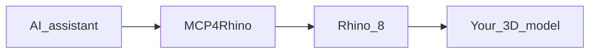

MCP4Rhino is a [Rhino 8](https://www.rhino3d.com/) plugin that hosts a local [Model Context Protocol (MCP)](https://modelcontextprotocol.io/) server. Claude, Cursor, and other MCP clients can create, inspect, and edit geometry in your open Rhino document.

Default endpoint: `http://127.0.0.1:4010/mcp`.

<Warning>
  Your assistant can create, modify, and delete geometry. Review changes in Rhino before you rely on them. Code-style checks return **findings only** — not a professional stamp or legal compliance claim.
</Warning>

## What you can do

<Columns cols={2}>
  <Card title="Create and edit models" icon="cube">
    Describe designs in natural language. Create curves, surfaces, solids, and architectural elements.
  </Card>
  <Card title="Inspect and measure" icon="ruler">
    List objects, measure size and distance, query layers and building semantics.
  </Card>
  <Card title="Drawings and export" icon="file-lines">
    Sections, elevations, sheets, PDF/DWG/IFC export, and viewport capture.
  </Card>
  <Card title="Iterate safely" icon="rotate">
    Hot-reload Tools while developing. Status dialog shows endpoint, logs, and support links.
  </Card>
</Columns>

## How it works

1. Install MCP4Rhino in Rhino (Package Manager or GitHub `.yak`).
2. Rhino opens; the MCP server usually auto-starts on Idle.
3. Connect Claude Desktop, Cursor, or another MCP client to `http://127.0.0.1:4010/mcp`.
4. Ask the assistant to work in the active document.

## Start here

<CardGroup cols={2}>
  <Card title="Quickstart" icon="rocket" href="/quickstart">
    Install, connect an assistant, and run your first request.
  </Card>
  <Card title="Connect Claude or Cursor" icon="plug" href="/guides/connect-claude-cursor">
    Exact MCP config for Claude Desktop and Cursor.
  </Card>
  <Card title="MCP tools" icon="wrench" href="/reference/mcp-tools">
    Full tool inventory for agents and developers.
  </Card>
  <Card title="Architecture" icon="sitemap" href="/explanation/architecture">
    Why host, Tools, and Logic are split — and when to restart Rhino.
  </Card>
</CardGroup>

## Requirements

- **Rhino 8** on Windows or macOS
- An MCP-compatible AI assistant (Claude Desktop, Cursor, or similar)
- [Node.js](https://nodejs.org/) for the usual `npx mcp-remote` bridge

Linux clients can point at a Windows Rhino host: `http://<windows-host>:4010/mcp`.

## Feedback

Bugs and enhancements: [GitHub Issues](https://github.com/isque03/mcp4rhino/issues).

From Rhino: **MCP4Rhino → Report issue…**, or ask your assistant to call `get_support_info` before filing.
