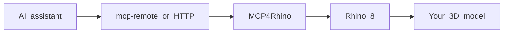

MCP4Rhino is a [Rhino 8](https://www.rhino3d.com/) plugin that hosts a local [Model Context Protocol (MCP)](https://modelcontextprotocol.io/) server. Your AI assistant connects to that server and can create, inspect, and edit geometry in the open document.

Rhino and the MCP server run on your machine. Rhino must be running. You bring your own AI client (Claude Desktop, Cursor, or any MCP-compatible assistant).

<Tip>
  Fastest path: [Quickstart](/quickstart) — install from Package Manager, connect your assistant, ask what is in the document.
</Tip>

## What you can do

<CardGroup cols={2}>
  <Card title="Create and edit geometry" icon="cube">
    Curves, surfaces, solids, and transforms driven by natural language.
  </Card>
  <Card title="Architectural modeling" icon="building">
    Levels, walls, slabs, roofs, openings, stairs, spaces, and semantic tags.
  </Card>
  <Card title="Inspect and measure" icon="ruler">
    List objects, measure size and distance, query building elements.
  </Card>
  <Card title="Drawings and export" icon="file-export">
    Sections, elevations, sheets, PDF/DWG/IFC, and viewport capture.
  </Card>
</CardGroup>

## How it fits together

Default endpoint: `http://127.0.0.1:4010/mcp`.

## Grasshopper support (alpha)

**MCP4Rhino 0.6.0-alpha** adds tools for editable **Grasshopper 1** definitions in Rhino 8. Your assistant can build a graph of parameters and relationships, request a solve, inspect data trees and diagnostics, save the definition, and explicitly bake geometry snapshots.

<Warning>
  Grasshopper support is experimental. Native graph, solve, undo, bake, and save/reopen validation is still pending licensed Windows and macOS testing. Enable **Include pre-releases** in Rhino Package Manager to try the alpha; stable users can stay on **0.5.3**.
</Warning>

<CardGroup cols={2}>
  <Card title="Grasshopper capabilities" icon="diagram-project" href="/grasshopper/overview">
    Learn about parameters, native graphs, preview, baking, and alpha limits.
  </Card>
  <Card title="Install and test the alpha" icon="flask" href="/grasshopper/install-alpha">
    Opt in, verify the version, build your first study, and return to stable.
  </Card>
</CardGroup>

## Next steps

<CardGroup cols={2}>
  <Card title="Quickstart" icon="rocket" href="/quickstart">
    Install, connect, and run your first prompt.
  </Card>
  <Card title="Connect Claude" icon="comments" href="/howto/connect-claude">
    Claude Desktop MCP config.
  </Card>
  <Card title="Connect Cursor" icon="cursor" href="/howto/connect-cursor">
    Cursor MCP server setup.
  </Card>
  <Card title="MCP tools" icon="wrench" href="/reference/mcp-tools">
    Full tool inventory for agents.
  </Card>
</CardGroup>
